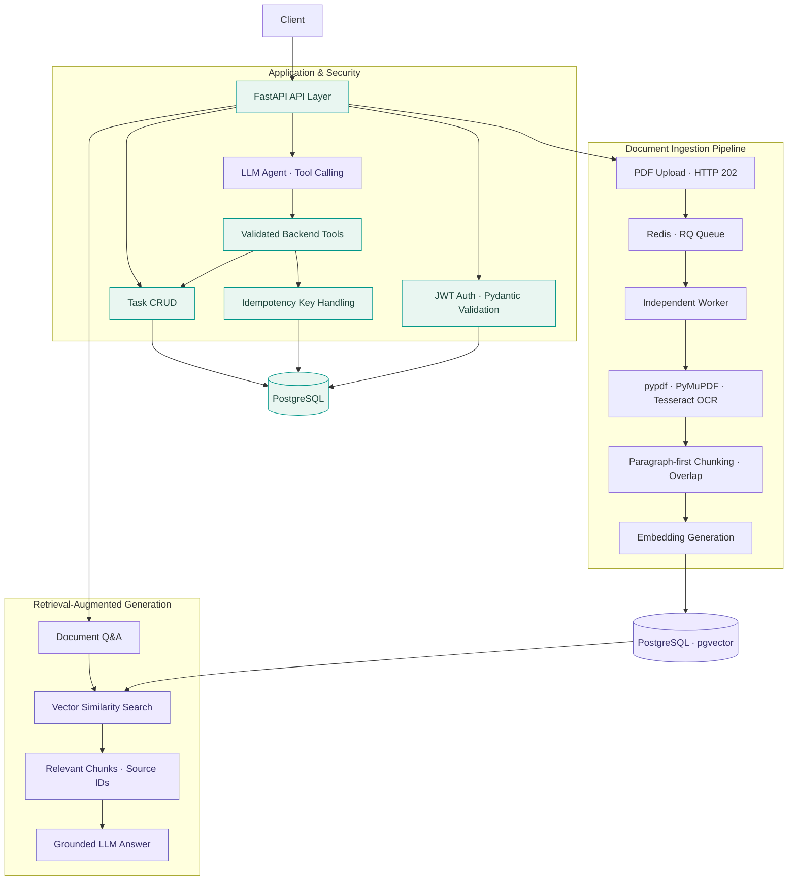

<div align="center">

# ⚡ AI TASK MANAGER

### Agentic Task Automation & Retrieval-Augmented Knowledge Platform

**An end-to-end AI backend built with FastAPI, LLM tool calling, RAG, and asynchronous document processing.**

<br />


<br />

[](https://github.com/EighthhDayy/ai-task-manager/actions/workflows/ci.yml)


<br />

[**Overview**](#overview) · [**Architecture**](#system-architecture) · [**Features**](#core-capabilities) · [**Quick Start**](#quick-start) · [**API**](#api-reference) · [**Engineering**](#engineering-highlights) · [**Roadmap**](#roadmap)

</div>

---

## Overview

**AI Task Manager** is a full-stack-infrastructure-oriented **AI backend system** that connects large language models to real business operations and private document knowledge.

Instead of stopping at a chatbot demo, the project combines **natural-language task management**, **controlled function execution**, **document-grounded question answering**, and **reliable background processing** in a modular FastAPI service.

<table>
  <tr>
    <td width="50%" valign="top">
      <h3>🤖 Agentic Operations</h3>
      Turn natural-language requests into authenticated backend tool calls for real task operations.
    </td>
    <td width="50%" valign="top">
      <h3>📚 Document Intelligence</h3>
      Upload PDFs, extract text or OCR scanned pages, index content, and answer questions using retrieved evidence.
    </td>
  </tr>
  <tr>
    <td width="50%" valign="top">
      <h3>⚙️ Asynchronous Execution</h3>
      Offload expensive document-processing pipelines to Redis/RQ workers and track job progress via APIs.
    </td>
    <td width="50%" valign="top">
      <h3>🛡️ Backend Reliability</h3>
      Enforce user-level data isolation, protect duplicate agent actions, and maintain typed, testable APIs.
    </td>
  </tr>
</table>

### What the system does

- **Manage tasks conversationally:** the LLM selects backend tools; application code validates and executes the operations.
- **Ask questions about documents:** a RAG pipeline retrieves relevant passages and generates context-grounded answers with source information.
- **Process scanned and text PDFs:** a hybrid extraction flow handles searchable pages and OCR-required pages.
- **Keep APIs responsive:** PDF processing and indexing run in an independent worker instead of blocking the upload request.
- **Preserve data boundaries:** JWT authorization and user-scoped database/retrieval queries restrict access to private resources.

## System Architecture



<details>
<summary><strong>How the document RAG pipeline works</strong></summary>

```text
PDF upload
    │
    ├─ Extract embedded text (pypdf)
    └─ OCR scanned pages (PyMuPDF + Tesseract)
    │
    ▼
Text preprocessing
    │
    ▼
Structure-aware Chunking Pipeline (planned upgrade)
    ├─ Regex-based heading detection (Python re)
    ├─ Section hierarchy & boundary detection
    ├─ Paragraph-first chunking within sections
    ├─ Sliding-window overlap for oversized text
    └─ Preserve heading context in each chunk
    │
    ▼
OpenAI text embeddings
    │
    ▼
PostgreSQL + pgvector
    │
    ▼
User-scoped similarity retrieval
    │
    ▼
Context-grounded LLM answer + source identifiers
```

</details>

## Core Capabilities

### 01 · LLM Agent & Tool Calling

An LLM-driven interaction layer interprets user instructions and selects backend operations such as task creation, listing, and updating.

**Key design:** the model proposes the tool and its arguments; **the backend executes the action** under the authenticated user's context. The LLM does not directly access the database.

- OpenAI Responses API integration
- Natural-language-driven task operations
- Function/tool calling and streamed responses
- Backend-side validation and user authorization
- Idempotency handling for task creation requests

### 02 · Retrieval-Augmented Generation (RAG)

The knowledge assistant answers user questions using retrieved document passages instead of relying solely on the model's general knowledge.

- OpenAI `text-embedding-3-small` embeddings
- 1,536-dimensional vectors stored using `pgvector`
- Cosine-distance semantic retrieval in PostgreSQL
- User-owned and shared-document access filtering
- Paragraph-first document chunking and overlap for long segments
- Context-grounded prompts with `Chunk ID` / `Source ID`
- Similarity threshold and explicit no-evidence abstention behavior
- API responses including answer text and retrieved chunk identifiers

> [!NOTE]
> Source attribution and prompt grounding **reduce risk**, but do not guarantee factual correctness. The system does not claim strict model-generated citation validation or zero hallucinations.

### 03 · PDF Parsing, OCR & Document Ingestion

A document processing layer supports both machine-readable PDFs and image-based scanned documents.

- **Text extraction:** pypdf
- **OCR fallback:** PyMuPDF page rendering + Tesseract
- **Preprocessing:** extracted text normalization and basic cleanup
- **Chunking:** paragraph-first segmentation with fixed-size overlap for long text
- **Indexing:** embeddings and vector records stored in PostgreSQL
- **Document replacement:** re-indexing can replace earlier chunks belonging to the same user and source

### 04 · Asynchronous Processing with Redis & RQ

Expensive PDF ingestion is decoupled from the HTTP request lifecycle.

```text
POST /ai/documents/upload-async
             │
             ▼
      Return 202 + job_id
             │
             ▼
          Redis / RQ
             │
             ▼
      Dedicated RQ worker
             │
             ▼
  Parse → OCR → Chunk → Embed → Index
             │
             ▼
GET /ai/document-jobs/{job_id}
```

The status endpoint verifies job ownership before exposing processing state. This architecture improves **request responsiveness**; it does not imply that end-to-end PDF processing finishes faster.

### 05 · Security, Data Integrity & Idempotency

| Concern | Implementation |
| :--- | :--- |
| **Authentication** | JWT bearer tokens and Argon2 password hashing |
| **Authorization** | User-scoped task records and document retrieval |
| **Schema validation** | Pydantic request/response models |
| **Database transactions** | SQLAlchemy sessions and explicit commit/rollback |
| **Duplicate task creation** | Idempotency keys and a database uniqueness constraint |
| **Concurrent writes** | `IntegrityError` recovery path for duplicate tool executions |
| **Schema migrations** | Version-controlled Alembic migrations |

## Technology Stack

| Category | Stack |
| :--- | :--- |
| **Language & API** | Python, FastAPI, Pydantic |
| **LLM integration** | OpenAI Responses API, Function Calling, streaming |
| **RAG** | Embeddings, custom retrieval pipeline, PostgreSQL + pgvector |
| **Document processing** | pypdf, PyMuPDF, Tesseract OCR |
| **Background jobs** | Redis, RQ, Worker |
| **Persistence** | PostgreSQL 18, SQLAlchemy, psycopg |
| **Authentication** | JWT, Argon2 |
| **Infrastructure** | Docker, Docker Compose, uv |
| **Testing & CI** | pytest, FastAPI TestClient, GitHub Actions |

## Quick Start

### Prerequisites

- [Docker Desktop](https://www.docker.com/products/docker-desktop/) and Docker Compose
- Git
- An OpenAI API key for agent and embedding features
- Tesseract OCR available in the runtime handling scanned PDFs

### 1. Clone the repository

```bash
git clone https://github.com/EighthhDayy/ai-task-manager.git
cd ai-task-manager
```

### 2. Create a `.env` file

Create a local `.env` file in the project root:

```dotenv
# PostgreSQL
DB_USER=app_user
DB_PASSWORD=replace-with-a-secure-password
DB_NAME=ai_task_manager
DB_HOST=db
DB_PORT=5432

# Authentication
SECRET_KEY=replace-with-a-long-random-secret

# LLM / Embeddings
OPENAI_API_KEY=your-openai-api-key

# Background jobs
REDIS_URL=redis://redis:6379/0
```

Keep credentials out of version control. In a non-container environment, use the database and Redis host addresses appropriate for that runtime.

### 3. Start the application stack

```bash
docker compose up --build -d
```

The containerized stack consists of an **API**, **PostgreSQL/pgvector**, **Redis**, and a **background worker**.

Apply database migrations as appropriate for the initialized database:

```bash
docker compose exec api uv run --no-sync alembic -c src/ai_task_manager/alembic.ini upgrade head
```

### 4. Open the API

| Service | Address |
| :--- | :--- |
| Interactive OpenAPI / Swagger UI | [http://localhost:8000/docs](http://localhost:8000/docs) |
| OpenAPI JSON | [http://localhost:8000/openapi.json](http://localhost:8000/openapi.json) |
| API root | [http://localhost:8000/](http://localhost:8000/) |

> **Tip:** Use Swagger UI to register, log in, authorize with a bearer token, create tasks, upload documents, and test document Q&A.

> **Security:** Do not use the example credentials in production. Configure real secrets, appropriate database permissions, TLS, and restrictive network access before any public deployment.

## API Reference

### Authentication & Task Management

| Method | Endpoint | Description |
| :--- | :--- | :--- |
| `POST` | `/users` | Register an account |
| `POST` | `/login` | Log in and obtain a JWT |
| `GET` | `/me` | Return the authenticated user |
| `GET` | `/my/tasks` | List the user's tasks |
| `POST` | `/my/tasks` | Create a task |
| `PATCH` | `/my/tasks/{task_id}` | Update a task |
| `DELETE` | `/my/tasks/{task_id}` | Delete a task |

### Document Intelligence

| Method | Endpoint | Description |
| :--- | :--- | :--- |
| `POST` | `/ai/documents` | Index a text document |
| `POST` | `/ai/documents/upload` | Upload and process a PDF |
| `POST` | `/ai/documents/upload-async` | Enqueue PDF ingestion and return job ID |
| `GET` | `/ai/document-jobs/{job_id}` | Check an async processing job |
| `POST` | `/ai/ask-docs` | Ask questions over indexed documents |

The Agent's tool-calling workflow also supports natural-language task operations. For the complete route definitions and current request schemas, use `/docs`.

<details>
<summary><strong>Example API flow — create a task</strong></summary>

**Register**

```bash
curl -X POST http://localhost:8000/users \
  -H "Content-Type: application/json" \
  -d '{"username":"demo","email":"demo@example.com","password":"choose-a-secure-password"}'
```

**Log in**

```bash
curl -X POST http://localhost:8000/login \
  -H "Content-Type: application/json" \
  -d '{"username":"demo","password":"choose-a-secure-password"}'
```

Copy the `access_token` from the response.

**Create a task**

```bash
curl -X POST http://localhost:8000/my/tasks \
  -H "Authorization: Bearer YOUR_ACCESS_TOKEN" \
  -H "Content-Type: application/json" \
  -d '{"title":"Review RAG architecture","completed":false,"description":"Prepare technical notes"}'
```

**Query tasks**

```bash
curl http://localhost:8000/my/tasks \
  -H "Authorization: Bearer YOUR_ACCESS_TOKEN"
```

</details>

## Engineering Highlights

### Grounded generation instead of unrestricted answers

The RAG flow retrieves a small number of relevant chunks, injects source identifiers into model context, and instructs the model to answer from the evidence. When retrieval yields no sufficiently relevant chunks, the API can return a no-evidence response without generating an unsupported answer.

### Idempotent business operations

An agent may retry a tool call after a timeout or repeat an operation. The task-creation flow associates the logical action with an idempotency key; the database uniqueness constraint and transaction-level conflict recovery prevent duplicate records for repeated requests using the same key.

### Responsive document APIs

The async upload endpoint acknowledges document submission with `202 Accepted` and a job ID. Redis/RQ executes OCR, chunking, embeddings, and indexing in a separate worker. Clients can poll the ownership-checked job status endpoint.

### Explicit engineering boundaries

- API-layer authentication does not replace row-level user-scoped queries.
- Returning retrieved source identifiers is not the same as validating every generated citation.
- Idempotent tool-based task creation does not automatically make every `POST` endpoint idempotent.
- Structure-aware chunking and retrieval performance gains require implementation and evaluation before they can be claimed.

## Testing & CI

The project uses **pytest** and FastAPI's **TestClient** for API integration testing, including authentication, task CRUD, database persistence, and cross-user authorization checks.

```bash
uv sync --frozen
uv run pytest
```

The test suite requires an isolated PostgreSQL test database and matching environment variables. The GitHub Actions workflow runs the tests with PostgreSQL as a service.

**No invented benchmarks:** latency improvements, hallucination reduction rates, and retrieval quality scores are intentionally omitted until supported by reproducible evaluation.

## Project Structure

```text
ai-task-manager/
├── .github/workflows/ci.yml
├── main.py
├── src/ai_task_manager/
│   ├── auth.py                   # JWT, password verification, auth dependencies
│   ├── database.py               # SQLAlchemy engine / database sessions
│   ├── models.py                 # Task, user, document persistence models
│   ├── schemas.py                # Pydantic request and response contracts
│   ├── llm.py                    # OpenAI client integration
│   ├── rag.py                    # Embeddings, retrieval, grounded QA
│   ├── chunking.py               # Paragraph-first text splitting
│   ├── ingestion.py              # Chunk generation and indexing
│   ├── pdf_utils.py              # PDF extraction and OCR
│   ├── queue_config.py           # Redis / RQ configuration
│   ├── document_jobs.py          # Background ingestion worker
│   ├── routers/                  # Auth, task, and AI endpoints
│   └── alembic/                  # Database migrations
├── tests/                         # API integration tests
├── Dockerfile
├── compose.yaml
├── pyproject.toml
└── uv.lock
```

## Roadmap

- [x] Authenticated task management with PostgreSQL
- [x] LLM Function Calling and streaming responses
- [x] Document RAG with embeddings and pgvector
- [x] PDF text extraction and OCR fallback
- [x] Redis/RQ asynchronous document indexing
- [x] Task-creation idempotency and concurrency conflict handling
- [x] Docker-based multi-service architecture
- [ ] Heading-aware / structure-aware document chunking
- [ ] Automated citation validation and stronger structured model output checks
- [ ] Retrieval quality evaluation (Hit@2, Recall@K, MRR)
- [ ] Load testing and reliability hardening for concurrent ingestion
- [ ] Demo screenshots and deployment walkthrough

---

<div align="center">

### Built beyond the chatbot.

**Designed to connect LLM reasoning, retrieval, and actual backend operations.**

<sub>Independent project · Python / FastAPI / LLM Systems Engineering</sub>

<br /><br />

[↑ Back to top](#-ai-task-manager)

</div>
